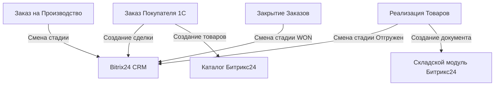

# 🚀 Интеграция 1С:УПП 1.3 и Bitrix24 (CRM + Склад)

Комплексное решение для двусторонней синхронизации документов, справочников и статусов между конфигурацией **1С:УПП 1.3** и **Bitrix24** через REST API.

## 📖 О проекте
Проект решает задачу разрозненности данных между учетной системой (1С) и CRM (Bitrix24). Теперь менеджеры работают в привычном Битриксе, а бухгалтерия — в 1С, при этом данные синхронизируются автоматически.

### 🏗 Архитектура решения

✨ Основные возможности

Автоматическое создание сделок: При записи документа ЗаказПокупателя в 1С создается сделка в нужной воронке (в зависимости от подразделения).
Умный маппинг: Контрагенты ищутся по названию, номенклатура — по GUID. Если их нет, они создаются автоматически.
Жизненный цикл: Сделка автоматически двигается по стадиям при создании связанных документов (Производство -> Реализация -> Закрытие).
Складской учёт: Создание документов Оприходование в складском модуле Bitrix24 на основе реализаций.
Автоматизация: Регламентное задание по поиску и закрытию «зависших» заказов с отправкой отчетов на почту.

🛠 Технологический стек
1С: Платформа 8.3 (УПП 1.3), подписки на события, регистры сведений, регламентные задания.
Библиотеки: OpenIntegrations (модули для HTTP-запросов).
Bitrix24: REST API (crm., catalog., user.*).

🚀 Быстрый старт
Создайте входящий вебхук в Bitrix24 с правами: crm, catalog, user.
Заполните константы в 1С (URL вебхука, ID каталога, ID воронок).
Импортируйте модули из папки src как общие модули (флаги: Сервер, Вызов сервера).
Настройте подписки на события для документов.

⚠️ Решенные проблемы (Troubleshooting)
В ходе разработки были решены специфические ошибки платформы и API. Подробнее в docs/Troubleshooting.md.
Обход ошибки Передача мутабельного значения при записи в типовые справочники.
Исправление бага API Битрикса с поиском контрагентов по XML_ID.
Обработка вложенных JSON-ответов складского модуля.

